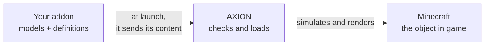

# Understand AXION

Before touching any code, let's take ten minutes to see how the pieces fit together. Everything else follows from
this.

## Minecraft, Forge, mods

Minecraft cannot load mods on its own. **Forge** does it: at launch, it finds each mod (a `.jar` file in the `mods/`
folder) and loads it into the game. AXION is a Forge mod, and your addon will be one too.

## AXION, the engine

AXION adds an **engine** to Minecraft: real physics (impacts, masses, wheels, suspensions), and 3D rendering for
objects far more detailed than blocks. But AXION contains **no object** of its own: no car, no crate. It waits for
another mod to give it some.

## Your addon, the content

That is your **addon**'s job: a small mod that tells AXION "here are my objects". For each object, it provides two
things:

- **a 3D model** (a glTF file: `.glb` or `.gltf`), its shape and colours, which you make in Blender;
- **a definition** (a JSON file), its sheet: which model, which kind of object, which mass, which materials.

!!! question "Why a mod, and not just a folder of files?"
    Because a mod can go further when you need it: Java code for your own behaviour, an item in the inventory, a
    command. To start with, your mod does only one thing: send its folder to AXION. The provided mod template already
    does it for you.

## The definition and the assembly

A **definition** is a recipe: it describes an object, once and for all. When you spawn the object in the world, AXION
builds an **assembly** from it: the real object, which falls, rolls and bumps. One definition can give as many
assemblies as you want, as a recipe gives as many dishes.

## Names: the namespace

Each mod has an identifier, its **modId**, in lowercase: `example_addon`. Everything your mod declares carries that
name in front, with a colon: the definition stored in `axion/definitions/crate.json` is called
`example_addon:crate`. That is the **namespace**: two mods can each have their own `crate` without getting in each
other's way.

## What happens at launch

1. Forge loads the mods, including AXION and yours.
2. Your mod sends its content to AXION.
3. AXION checks everything: a misspelt field, an impossible mass, a missing model. What is wrong is dropped and
   written to the game log, with the file name; the rest loads.
4. In game, `/axion spawn example_addon:crate ^ ^1 ^3` spawns your crate three blocks in front of you.

!!! tip "Remember this above all"
    Your addon **declares**, AXION **checks and brings to life**. If your object does not show up, the game log tells
    you why.
