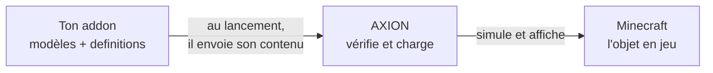

# Comprendre AXION

Avant de toucher au code, prenons dix minutes pour voir comment les pièces s'emboîtent. Tout le reste en découle.

## Minecraft, Forge, les mods

Minecraft ne sait pas charger de mods tout seul. **Forge** s'en charge : au lancement, il trouve chaque mod (un
fichier `.jar` dans le dossier `mods/`) et le charge dans le jeu. AXION est un mod Forge, et ton addon le sera aussi.

## AXION, le moteur

AXION ajoute à Minecraft un **moteur** : de la vraie physique (chocs, masses, roues, suspensions), et un rendu 3D
pour des objets bien plus détaillés que des blocs. Mais AXION ne contient **aucun objet** à lui : pas de voiture, pas
de caisse. Il attend qu'un autre mod lui en donne.

## Ton addon, le contenu

C'est le rôle de ton **addon** : un petit mod qui dit à AXION « voici mes objets ». Pour chaque objet, il fournit
deux choses :

- **un modèle 3D** (un fichier glTF : `.glb` ou `.gltf`), sa forme et ses couleurs, que tu fais dans Blender ;
- **une definition** (un fichier JSON), sa fiche : quel modèle, quel genre d'objet, quelle masse, quels matériaux.

!!! question "Pourquoi un mod, et pas juste un dossier de fichiers ?"
    Parce qu'un mod peut aller plus loin quand tu en auras besoin : du code Java pour un comportement à toi, un objet
    dans l'inventaire, une commande. Pour commencer, ton mod ne fait qu'une chose : envoyer son dossier à AXION. Le
    modèle de mod fourni le fait déjà pour toi.

## La definition et l'assembly

Une **definition** est une recette : elle décrit un objet, une fois pour toutes. Quand tu fais apparaître l'objet
dans le monde, AXION en construit une **assembly** : l'objet réel, qui tombe, roule et se cogne. Une definition peut
donner autant d'assemblies que tu veux, comme une recette donne autant de plats.

## Les noms : l'espace de noms

Chaque mod a un identifiant, son **modId**, en minuscules : `example_addon`. Tout ce que ton mod déclare porte ce nom
devant, avec deux-points : la definition rangée dans `axion/definitions/crate.json` s'appelle
`example_addon:crate`. C'est l'**espace de noms** : deux mods peuvent avoir chacun leur `crate` sans se gêner.

## Ce qui se passe au lancement

1. Forge charge les mods, dont AXION et le tien.
2. Ton mod envoie son contenu à AXION.
3. AXION vérifie tout : un champ mal écrit, une masse impossible, un modèle introuvable. Ce qui est faux est écarté et
   écrit dans le journal du jeu, avec le nom du fichier ; le reste se charge.
4. En jeu, `/axion spawn example_addon:crate ^ ^1 ^3` fait apparaître ta caisse trois blocs devant toi.

!!! tip "Retiens surtout ceci"
    Ton addon **déclare**, AXION **vérifie et fait vivre**. Si ton objet n'apparaît pas, le journal du jeu te dit
    pourquoi.
