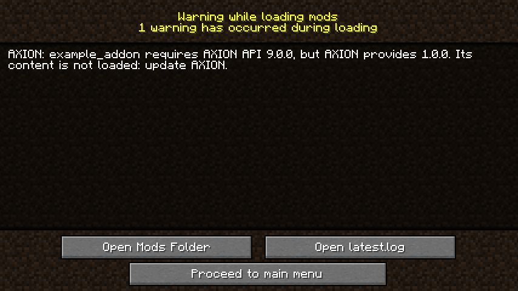

# Versions

Your addon is compiled against a version of AXION's API. If a player installs it with an older AXION, a method your
addon needs may be missing. Rather than an unintelligible crash, AXION can warn them — provided you say which version
you need.

## Say which API version you need

In `src/main/resources/META-INF/mods.toml`, without a line of Java:

```toml
--8<-- "java/addon-temoin/src/main/resources/META-INF/mods.toml:api"
```

The value is the **minimum** version: `"1.0"` accepts 1.0, 1.1, 1.2… but not 2.0, which may have changed things (the
semantic versioning rule). Write it **in quotes**: without them, `1.10` would become `1.1`.

## What the player sees

If their AXION is too old, Forge shows at the end of loading:



The game still starts (*Proceed to main menu*), without your addon's content: a world that already holds its objects
opens, and those objects stay inert and intact until your addon loads again. The game log says the same.

!!! question "And AXION's version, in the dependencies?"
    The `axion` dependency of your `mods.toml` (its `versionRange`) is about the version of the AXION **mod**, not its
    API: the two move separately. Keep both: the first guarantees AXION is there, the second that it has the API you
    need.

## Which version to declare?

The one of the API you compile against, named by your `gradle.properties` (`axion_api_version`): for example
`1.0.0-SNAPSHOT` gives `axion_api = "1.0"`. If you only use older methods, you can declare less, and your addon will
work with more AXION versions.
