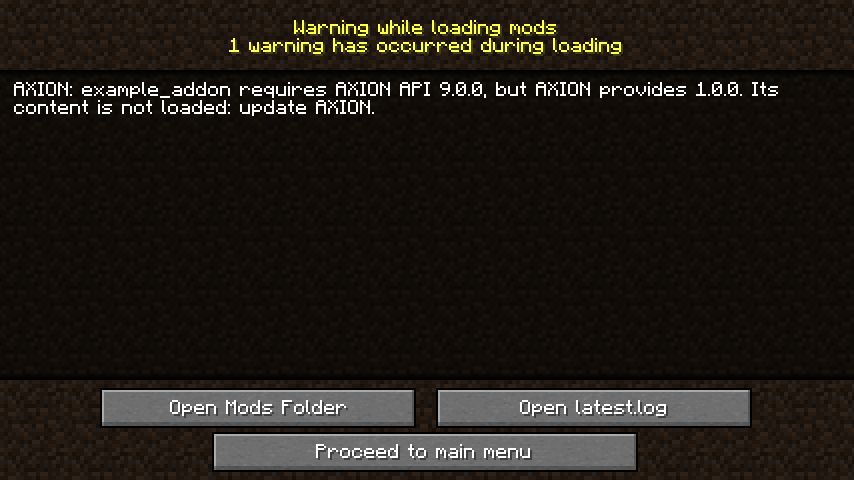

# Versions

Ton addon est compilé contre une version de l'API d'AXION. Si un joueur l'installe avec un AXION plus ancien, une
méthode dont ton addon a besoin peut manquer. Plutôt qu'un plantage incompréhensible, AXION peut le prévenir — à
condition que tu dises quelle version il te faut.

## Dire quelle version de l'API il te faut

Dans `src/main/resources/META-INF/mods.toml`, sans une ligne de Java :

```toml
--8<-- "java/addon-temoin/src/main/resources/META-INF/mods.toml:api"
```

La valeur est la version **minimale** : `"1.0"` accepte 1.0, 1.1, 1.2… mais pas 2.0, qui peut avoir changé des choses
(la règle du versionnement sémantique). Écris-la **entre guillemets** : sans eux, `1.10` deviendrait `1.1`.

## Ce que voit le joueur

Si son AXION est trop ancien, Forge affiche à la fin du chargement :



Le jeu démarre quand même (*Proceed to main menu*), sans le contenu de ton addon : un monde qui en contient déjà des
objets s'ouvre, et ces objets restent inertes et intacts jusqu'à ce que ton addon se charge de nouveau. Le journal du
jeu dit la même chose.

!!! question "Et la version d'AXION, dans les dépendances ?"
    La dépendance `axion` de ton `mods.toml` (sa `versionRange`) porte sur la version **du mod** AXION, pas de son
    API : les deux avancent séparément. Garde les deux : la première garantit qu'AXION est là, la seconde qu'il a
    l'API qu'il te faut.

## Quelle version déclarer ?

Celle de l'API que tu compiles, que ton `gradle.properties` nomme (`axion_api_version`) : par exemple `1.0.0-SNAPSHOT`
donne `axion_api = "1.0"`. Si tu n'utilises que des méthodes plus anciennes, tu peux déclarer moins, et ton addon
fonctionnera avec davantage de versions d'AXION.
